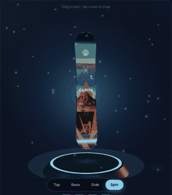
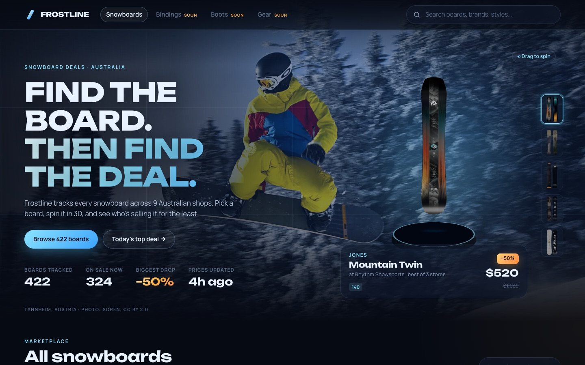
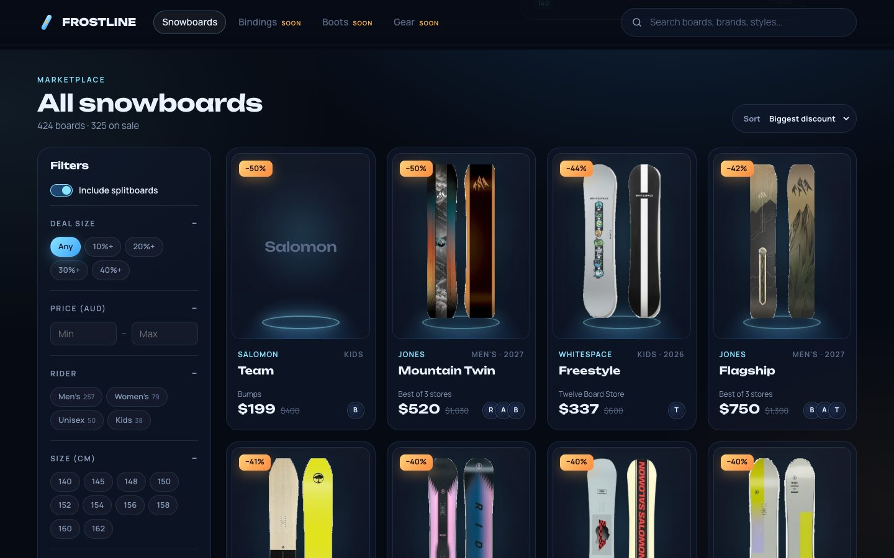
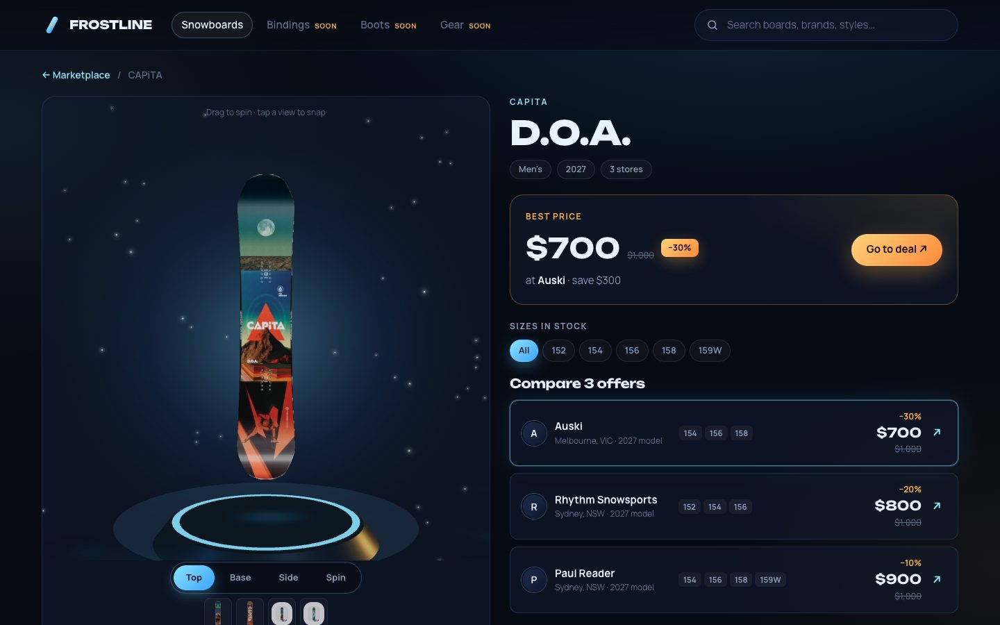

<div align="center">

# ❄️ Frostline

**An interactive marketplace for snowboard deals across Australia.**

Find a board, spin it in 3D, and see which shop sells it for the least.

[**Live demo → frostline.joshrkhoo.com**](https://frostline.joshrkhoo.com) · [frostline-nine.vercel.app](https://frostline-nine.vercel.app)




</div>

---

## What it is

Frostline isn't a general shopping search. It's a marketplace built only for snowboards and only for deals:

- **Board first, then shops.** Each board appears once. Open it to compare every Australian shop selling it, with price, original price, discount and sizes in stock.
- **See the whole board.** Every board can be spun in 3D: top sheet, base and sidewall. The 3D model is built from the shops' own product photos.
- **Deals up front.** Discounts compare against the same season's RRP, so an older model never looks like a bigger saving than it is.

Today it tracks **~420 in-stock boards from 9 shops**. Bindings, boots and other gear are planned.

## Screenshots

| Home | Marketplace |
| --- | --- |
|  |  |

| Board page |
| --- |
|  |

## Features

**Marketplace**
- Search across brand, model, year, terrain and profile. It tolerates spacing differences, so "counter balance" matches "Counterbalance".
- Filters for deal size, price range, rider (men's, women's, kids), board length, terrain, camber profile, brand, store and splitboards.
- Sort by biggest discount, price, number of stores or name.
- Every board photo has its studio backdrop removed by an AI segmentation model (BiRefNet), so all boards float on the same dark ice stage instead of white or grey boxes. This includes white boards shot on white. Cards always show an upright photo of the whole board, lift on hover, and switch to another product shot of the board (base or another angle). Lifestyle photos and close-ups are skipped automatically.

**Featured deals**
- A full-bleed snowboarding photo sits behind the headline, colour-graded into the site's ice palette with a slow drift.
- The hero shows today's biggest markdowns on a 3D pedestal, with the shop offering the deal and the sizes in stock at that price.

**Board page**
- 3D viewer: drag to spin with inertia, or snap to **Top / Base / Side**. The board floats above a glowing ice pedestal.
- The 3D board is shaped by its camber profile (camber, rocker, hybrid camber, hybrid rocker or flat), at close to real proportions.
- Best price at a glance, with the saving and a link straight to the shop.
- Every offer from every store, with the cheapest highlighted. Pick a size to see only the shops that have it in stock.
- Specs (profile, shape, flex, level, terrain, season) merged from all stores' data.
- "More deals like this" from the same brand or terrain.

**Data**
- Prices re-scraped daily by a GitHub Action.
- Only in-stock listings are kept.

## How it works

```
 ┌──────────────── scraper (Node, daily via GitHub Actions) ────────────────┐
 │                                                                         │
 │  9 Shopify stores ──► /products.json ──► classify ──► normalize ──► match │
 │  (paged, polite)        ~57k products     boards only   brand/model/     │
 │                                                          size/price/specs│
 └───────────────────────────────────────────────┬─────────────────────────┘
                                                 ▼
                                    public/data/boards.json  (static)
                                                 │
                     scraper/cutouts.py (Python, BiRefNet) ──► public/cutouts/  (masks)
                                                 │
 ┌──────────────────── React app (Vercel) ───────┴─────────────────────────┐
 │  search + filters ──► cards ──► board page ──► 3D viewer                │
 │                                               (built from product photos)│
 └─────────────────────────────────────────────────────────────────────────┘
```

### 1. Scraping
Every tracked shop runs on Shopify, which exposes the catalogue publicly at `/products.json`. The scraper pages through each one with a small delay between requests, and backs off exponentially and retries when the shop answers 429 or a 5xx. If a shop still fails, its listings from the previous `boards.json` are kept, so one flaky store never empties out of the site for a day. It caches the raw download in `.cache/` so you can iterate without hitting the shops again.

### 2. Classifying
Shops file snowboards very differently: `Snowboards`, `Mens Snowboards`, a generic `Snowboard` type covering every snow product, a `Boards` type plus a `snowboard` tag, or no type at all with a `JUNIOR SNOWBOARDS` tag. `classify.ts` handles all of these and drops boots, bindings, bags, outerwear and accessories.

### 3. Normalizing
`normalize.ts` turns each product into a listing. It:
- extracts the bare model name from titles like `Ride Mens Warpig Snowboard (2024)`, `Nitro Dinghy Snowboard | 2027` and `Jones 2027 Howler Splitboard - 161cm`
- detects season, rider and splitboard
- normalises sizes (`156cm Wide` → `156W`)
- reads the price and the shop's `compare_at_price` (the original price), so discounts are the shops' own markdowns
- parses specs from at least four different tag schemes

### 4. Matching
`match.ts` groups listings into one board by brand plus a normalised model key. The key handles spacing and naming differences, such as "Counter Balance" vs "Counterbalance Camber". Kids "Grom" versions stay separate from the adult boards. The board's discount compares the best in-stock price with the same season's RRP.

### 5. Cut-outs and 3D from product photos
**Cut-outs.** `scraper/cutouts.py` runs the BiRefNet segmentation model (via [rembg](https://github.com/danielgatis/rembg)) over every board photo once, and saves a small mask cropped to the board(s) plus a manifest in `public/cutouts/`. Anything enclosed by a board's outline is made solid, so pale boards never come out see-through. BiRefNet also tends to treat a studio drop shadow as part of the board, which shows as a pale strip down one edge of a dark board. A conservative trim cuts it off: only on light, neutral backdrops, and only for a smooth grey band that fades away from the board and runs a consistent width along at least a quarter of its length. Saved masks get the trim without rerunning the model (tracked by a `t` version in the manifest). The script also records which photos are lifestyle shots (no plain backdrop), close-ups that run off the frame, or boards lying sideways. In the browser, `src/lib/cutout.ts` draws the photo through its mask, and cards pick the first upright, whole-board photo. Photos added since the last mask run fall back to colour-matching the backdrop in the browser.

**3D.** No 3D models are needed. `src/lib/boardArt.ts` runs in the browser:
1. Loads the product photos from Shopify's CDN, which allows cross-origin image reads.
2. Separates the board from the plain backdrop and finds each upright board by scanning columns. This handles top and base side by side in one photo, separate top and base photos, and side-profile shots (which it skips).
3. Crops each board, records its outline row by row, and extends the edge colours outward so the backdrop never shows at the edges.

`src/three/boardGeometry.ts` then builds a mesh that follows that outline exactly. It has rocker at the nose and tail, metal-edged sidewalls, the top-sheet photo on top and the base photo mirrored onto the bottom. A board with no usable photos gets a generated design instead.

## Tech stack

| Layer | Tools |
| --- | --- |
| Front end | React 19, TypeScript, Vite |
| 3D | three.js, @react-three/fiber, @react-three/drei (lighting, contact shadows, snow sparkles) |
| Styling | Hand-written CSS with design tokens. Unbounded and Manrope fonts |
| Scraper | Node 22, TypeScript via `tsx`, native `fetch` |
| Cut-outs | Python 3.11, rembg + BiRefNet (ONNX, CPU), NumPy, SciPy, Pillow |
| Data | One static JSON file (`public/data/boards.json`, about 200 KB gzipped) |
| Hosting | Vercel (static site) |
| Automation | GitHub Actions, scheduled daily scrape |

There's no backend or database. The site is plain static files, and three.js is lazy-loaded so the marketplace renders before the 3D bundle arrives.

## Stores tracked

| Store | Website | Location | Boards in stock |
| --- | --- | --- | --- |
| Balmoral Boards | [balmoralboards.com.au](https://balmoralboards.com.au) | Sydney, NSW | ~185 |
| Auski | [auski.com.au](https://auski.com.au) | Melbourne, VIC | ~160 |
| Rhythm Snowsports | [rhythmsnowsports.com.au](https://rhythmsnowsports.com.au) | Sydney, NSW + resorts | ~145 |
| Twelve Board Store | [twelveboardstore.com.au](https://twelveboardstore.com.au) | Melbourne, VIC | ~115 |
| Melbourne Snowboard Centre | [melbournesnowboard.com.au](https://www.melbournesnowboard.com.au) | Preston, VIC | ~90 |
| Paul Reader | [paulreader.com.au](https://paulreader.com.au) | Sydney, NSW | ~30 |
| Snow Monkey | [snowmonkey.com.au](https://snowmonkey.com.au) | Melbourne, VIC | ~25 |
| Larry Adler | [larryadler.com.au](https://larryadler.com.au) | Sydney, NSW | ~12 |
| Bumps | [bumps.com.au](https://bumps.com.au) | Elsternwick, VIC | ~1 (little snow stock online) |

Counts change with every scrape. The live numbers are on the site under **Tracked stores**.

**Not yet supported.** These need their own adapters:
- **Boardworld:** Shopify, but its snow range is hidden from the public feed. It would need the shop's search-filter API.
- **Boardcave:** Shopify, but returns 403 to the feed.
- **X-Dream, STM, Boardstore, Wild Earth, Anaconda:** not on Shopify, so each needs HTML scraping.

## Getting started

Requires Node 22+. Python 3.11 is only needed to regenerate cut-out masks.

```bash
git clone git@github.com:joshrkhoo/frostline.git
cd frostline
npm install
npm run dev            # http://localhost:5173, using the committed boards.json
```

### Scripts

| Command | What it does |
| --- | --- |
| `npm run dev` | Start the Vite dev server |
| `npm run build` | Typecheck the app and scraper, then build to `dist/` |
| `npm run preview` | Serve the production build locally |
| `npm run scrape` | Download every store's catalogue and rebuild `public/data/boards.json` (~1–2 min) |
| `npm run scrape:cached` | Rebuild `boards.json` from the last download in `.cache/`, without network calls |
| `python scraper/cutouts.py` | Make masks for photos that don't have one yet, and re-trim older masks (`pip install -r scraper/requirements.txt` first; about 10s per photo on CPU) |

### Adding a store
For a Shopify store, add one line to `scraper/stores.ts`:

```ts
{ id: 'mystore', name: 'My Store', domain: 'mystore.com.au', location: 'Hobart, TAS', platform: 'shopify' },
```

Then run `npm run scrape` and check the per-store board count in the output. If it's 0, see how that store labels its boards (product type or tags) and extend `scraper/classify.ts`.

## Project structure

```
frostline/
├── scraper/
│   ├── stores.ts          shops to track
│   ├── shopify.ts         paginated products.json fetcher with retry
│   ├── classify.ts        is this product a snowboard?
│   ├── normalize.ts       product → listing (model, sizes, price, specs)
│   ├── match.ts           listings → boards across stores
│   ├── index.ts           entry point, writes public/data/boards.json
│   └── cutouts.py         photo → background-removal mask (BiRefNet)
├── src/
│   ├── lib/
│   │   ├── boardArt.ts    photo → board textures and outline
│   │   ├── cutout.ts      photo + mask → transparent cut-out
│   │   ├── filters.ts     search, filters, sorting, facets
│   │   ├── data.ts        loads boards.json
│   │   ├── router.ts      hash router (#/board/:id)
│   │   └── format.ts      AUD formatting, Shopify image resizing
│   ├── three/
│   │   ├── boardGeometry.ts   outline → mesh (rocker, sidewalls, UVs)
│   │   ├── BoardModel.tsx     drag-to-spin, preset views, idle float
│   │   ├── BoardStage.tsx     canvas, lights, pedestal, sparkles
│   │   └── LazyBoardStage.tsx loads three.js on demand
│   └── components/        Header, Hero, Marketplace, FilterPanel, BoardCard, BoardImage, BoardDetail, StoresSection
├── public/data/boards.json    scraped data (updated daily)
├── public/cutouts/            board masks + index.json (updated daily)
├── .github/workflows/scrape.yml
└── docs/screenshots/
```

## Deployment

- **Hosting:** Vercel, as a static Vite build. The repo is connected to Vercel, so every push to `main` deploys automatically.
- **Daily data:** `.github/workflows/scrape.yml` runs every day at 19:00 UTC (about 6am in eastern Australia). It runs the scraper, makes masks for any new photos, and commits the updated `boards.json` and `public/cutouts/`. The run is long, so the commit is rebased onto `main` before pushing in case `main` moved meanwhile. That commit triggers a fresh Vercel deploy, so the live prices are never more than a day old. It can also be triggered by hand from the Actions tab.

## Pricing APIs

There's no snowboard-specific pricing API, and no Australian one either. The options are:

| Option | Notes |
| --- | --- |
| **Shopify `/products.json`** (used) | Free, public and structured. Includes `compare_at_price`, so we get real "was" prices. Unofficial, so a shop can turn it off. |
| General price APIs (PriceAPI, Zyla Labs) | Paid, and focused on Amazon, eBay and Google Shopping. Little coverage of Australian specialist snow shops. |
| Google Shopping (SerpApi etc.) | Paid. Wider reach, but noisier data. |
| Affiliate feeds (Commission Factory) | The official route: full product feeds plus commission on click-outs. Worth applying for once the site has traffic. |

## Roadmap

- [ ] Bindings, boots, outerwear and accessories
- [ ] Price history and price-drop alerts
- [ ] Adapters for non-Shopify shops (X-Dream, STM, Boardstore)
- [ ] Boardworld via its search API
- [ ] Size-aware best price on cards
- [x] Auto-deploy on each daily data commit

## Credits

- Visual direction inspired by [Frozeverse – in-game NFT Marketplace](https://dribbble.com/shots/19106417-Frozeverse-in-game-NFT-Marketplace) by Phenomenon Studio; the photo hero takes after [STRYDE – Snowboard Website E-Commerce](https://dribbble.com/shots/27469068-STRYDE-Snowboard-Website-E-Commerce) by Hatypo Studio.
- Hero photo: "Snowboarder in flight (Tannheim, Austria)" by Sören from Germany, [CC BY 2.0](https://creativecommons.org/licenses/by/2.0), via [Wikimedia Commons](https://commons.wikimedia.org/wiki/File:Snowboarder_in_flight_(Tannheim,_Austria).jpg). Mirrored, cropped and colour-graded.
- Board photos, prices and stock belong to the retailers listed above. Frostline links to their stores for every purchase.

> Prices and stock can change at any time. Always check the retailer's site before buying.
